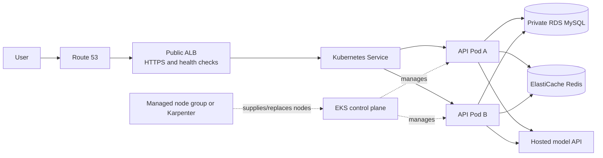

# AWS Production Plan: EKS

Status: proposed architecture. This is a target plan, not a deployed environment.

## Recommendation

Use Amazon EKS only when the application needs multiple replicas, node replacement, and rolling releases. For the current demo traffic, EKS is much more expensive than the single Lightsail host discussed separately. Kubernetes does not remove the cost of keeping minimum capacity available: the EKS control plane, load balancer, compute, database, and network resources continue to cost money while idle.

Keep MySQL out of Kubernetes. Use Amazon RDS for MySQL in private subnets, initially Single-AZ for a low-cost staging environment and Multi-AZ for the production service that needs database failover. The current local database is about 383 MiB including estimated indexes, so start with the smallest RDS class that passes load testing and has enough storage headroom.

Keep local sentence-transformer embeddings disabled with `AI_LOCAL_EMBEDDINGS_ENABLED=false` and install `requirements.txt` (not `requirements-dev.txt`). The production dependency set excludes Torch and sentence-transformers, and the setting makes the app ignore any legacy `hybrid` value in the database. Current database settings are `llm` for each role and `rag_mode=off`; the local API run passed readiness with the local model unloaded. If semantic routing is enabled later, use the hosted embedding provider and account for its usage separately.

## Target request path

## What happens when something fails or traffic rises

| Event | Response |
| --- | --- |
| A request handler hangs or the process dies | The liveness probe fails and Kubernetes restarts that pod. |
| A pod starts but is not ready | The readiness probe keeps it out of the Service and ALB target set until it is ready. Other healthy replicas keep serving. |
| A node fails | EKS managed node group / EC2 Auto Scaling replaces the node. Kubernetes reschedules its pods onto healthy capacity. Keep at least two API replicas across two Availability Zones and use a PodDisruptionBudget so a planned drain cannot evict both. |
| Requests increase | Horizontal Pod Autoscaler adds API pods when CPU/memory (and later a measured latency or in-flight request metric) crosses a target. |
| New pods cannot fit | Karpenter or Cluster Autoscaler adds an EC2 node. It can only add capacity after metrics and scheduling show that pods do not fit, so bursts can briefly queue while a node starts. |
| Traffic drops | HPA removes extra pods; the node autoscaler consolidates unused nodes. Keep two replicas and two nodes as the availability floor; scale-to-zero is not appropriate for an always-shareable store. |
| RDS primary has a failure (Multi-AZ) | RDS promotes its standby. The API must retry transient connection failures and reconnect through the RDS endpoint. |
| Model provider is slow or rate-limited | Keep the existing timeout/fallback behavior, cap concurrent requests and spending, and return a clear retry response. More pods do not increase the provider quota. |

Kubernetes HPA and node autoscaling are separate: HPA creates pods; Karpenter/Cluster Autoscaler creates the nodes needed to schedule those pods. AWS documents both layers and EKS managed-node replacement behavior. See [EKS autoscaling](https://docs.aws.amazon.com/eks/latest/userguide/autoscaling.html) and [managed node groups](https://docs.aws.amazon.com/eks/latest/userguide/managed-node-groups.html).

## Initial production topology

- One EKS cluster in one AWS region, spanning at least two Availability Zones.
- Two small On-Demand worker nodes as the floor, with a tested maximum of four to start. Use a managed node group for the first version; add Karpenter only if node right-sizing or scale-up speed justifies the extra operational component.
- API Deployment with two replicas minimum, one Uvicorn worker per pod, rolling updates, and a PodDisruptionBudget with `minAvailable: 1`.
- Initial pod requests: `cpu: 250m`, `memory: 512Mi`; limits: `cpu: 1`, `memory: 1Gi`. These are starting values based on a local API process peak of about 210 MiB without a chat request. Revisit using Linux pod peak memory and load-test data before launch; do not treat the local measurement as a production capacity result.
- HPA: minimum two, maximum eight API pods, initially target 65% average CPU. Add memory or request-latency/in-flight-request targets only after observing real traffic. CPU alone can miss an app waiting on external model calls.
- Public Application Load Balancer with HTTPS certificate from ACM. API pods/nodes and RDS stay private; expose only HTTPS publicly and restrict cluster administration access.
- RDS MySQL, encrypted, private, automated backups / point-in-time recovery, and Multi-AZ for production. Do not run MySQL as a pod or on the same node group as the API.
- ECR for immutable container images. CI builds and scans an image, pushes a versioned tag, then rolls out the Deployment. Keep the previous image available for rollback.
- AWS Secrets Manager (or an equivalent encrypted secret store) for JWT secret, model API key, and database credentials; expose them to pods through a narrowly scoped IAM role. Never put `.env` or secrets in the image.
- CloudWatch logs and alarms for pod restarts, unavailable replicas, node capacity, RDS connections/free storage/CPU, ALB 5xx/latency, and model spend. Add a hard model provider budget/cap because the app checklist records that its AI budget is currently reporting-only.
- RDS backups plus a tested restore procedure. Enable S3 versioning only if the application later stores uploaded files or export artifacts there.

## Changes needed before horizontal scaling

1. **Make caches shared or accept bounded staleness.** `api/main.py` keeps catalog results and admin dashboard data in per-process memory. Product changes clear only the cache in the pod that handled the edit; other pods can serve cached catalog results until the 10-minute TTL expires, and dashboard copies can remain stale for five minutes. Move cache entries/invalidation to Redis (or publish invalidation to every replica) before promising immediate cross-pod consistency.
2. **Make per-user chat serialization distributed.** The production checklist already calls out concurrent messages for one user. A Python lock is process-local; use a Redis lock or a database-backed lease with an expiry so requests routed to different pods still serialize.
3. **Run background jobs once.** The README says `ai.scheduler run` runs as a separate process. Do not start it in every API pod. Run it as a dedicated Deployment with leader election or convert each periodic job to a Kubernetes CronJob with a concurrency policy and idempotency.
4. **Reduce and budget DB connections.** Current pools can allow up to 15 app + 18 customer-agent + 10 seller-agent + 10 admin-agent connections per process. With replicas/workers this multiplies. Start with one worker per pod and explicit small per-pool caps; calculate `max pods × workers × sum(pool caps)` and keep it below RDS `max_connections` with room for migrations and admin work.
5. **Require production settings at startup.** Fail startup if `JWT_SECRET`, database passwords, or the required model key are absent. Keep `DEMO_LOGIN=false`, use HTTPS, set secure cookies, and configure the least-privilege database users. Do not deploy the local `.env` file.
6. **Separate liveness from dependency readiness.** Use `/api/health` for liveness so a temporary RDS outage does not restart every pod; use `/api/ready` for readiness, and make sure an RDS outage returns traffic to a useful error path while RDS recovers. Add a bounded startup probe for warm-up.
7. **Finish the open production checklist.** In particular: guest quota abuse protection, model budget enforcement, HTTPS secure cookies, app DB least privilege, database/app backups and restore, rate/concurrency limits, and data minimization. Kubernetes cannot fix application-level security gaps.

The React frontend is already built and served by the FastAPI process, so one API image can serve both frontend and API. Run one process per pod; do not also run the README's separate scheduler process inside the same web container.

## Autoscaling safety limits

- Put a maximum on API pods and nodes and alert before reaching it.
- Apply per-user/IP rate limits and a global cap to guest/model calls. Scale-out otherwise multiplies paid model requests.
- Cap model-call concurrency independently of pod count and observe provider quota/errors.
- Set container memory limits and database pool caps before enabling HPA.
- Use topology spread constraints across Availability Zones and a PDB for safe upgrades and node drains.
- Use a short scale-down stabilization window so chat streams are not interrupted by rapid pod removal.
- Do not use Spot capacity for the minimum serving floor. It can be an optional pool for interruption-tolerant work after graceful draining is verified.

## Cost reality (illustrative US East prices; verify the exact region in AWS Pricing Calculator before provisioning)

These are fixed-cost references, not a complete quote:

- EKS standard-support cluster fee: `$0.10/hour`, about **$73/month** or **$16.80 per week**, before EC2 nodes.
- One public ALB: about `$0.0225/hour` base, about **$16.40/month**, plus load-balancer capacity usage.
- A NAT Gateway: `$0.045/hour` plus processed data, about **$32.85/month per gateway** before data. High-availability private subnets commonly use one per Availability Zone.
- Add worker nodes, EBS, RDS compute/storage/backup, Route 53, CloudWatch, data transfer, and model API charges.

Thus an HA EKS design will cost substantially more than the `$12/month` single Lightsail server. Autoscaling helps avoid excess worker nodes at low traffic; it does not remove the EKS control-plane fee, ALB, database, or the minimum two-node/two-replica availability floor. A public-subnet node design can avoid NAT gateway fixed charges for a small controlled environment, but nodes need strict security groups and no inbound access; review that trade-off with the security owner. AWS discusses NAT and endpoint trade-offs in its [EKS networking cost guidance](https://docs.aws.amazon.com/eks/latest/best-practices/cost-opt-networking.html).

## Rollout stages

1. **Demo:** single Lightsail VM with hosted LLM, local embeddings off, backup/export documented. No HA promise.
2. **Staging:** container image, one EKS node, Single-AZ RDS, ingress/probes, basic CloudWatch and infrastructure-as-code. This is for deployment rehearsal, not uptime guarantees.
3. **Production launch:** two AZs, two nodes, two API replicas, ALB+HTTPS, private Multi-AZ RDS, autoscaling, secrets, rate/budget limits, Redis for shared coordination, and backup restore test.
4. **Growth:** load test realistic catalog/chat concurrency; tune HPA, connection pools, node max, model concurrency and RDS size using observed metrics. Add nodes only when pending pods prove capacity is needed.

## AWS references

- [EKS pricing](https://aws.amazon.com/eks/pricing/)
- [EKS scaling compute](https://docs.aws.amazon.com/eks/latest/userguide/autoscaling.html)
- [Managed node groups](https://docs.aws.amazon.com/eks/latest/userguide/managed-node-groups.html)
- [EKS high availability practices](https://docs.aws.amazon.com/eks/latest/best-practices/application.html)
- [EKS network cost optimization](https://docs.aws.amazon.com/eks/latest/best-practices/cost-opt-networking.html)
- [RDS for MySQL pricing and Multi-AZ](https://aws.amazon.com/rds/mysql/pricing/)
