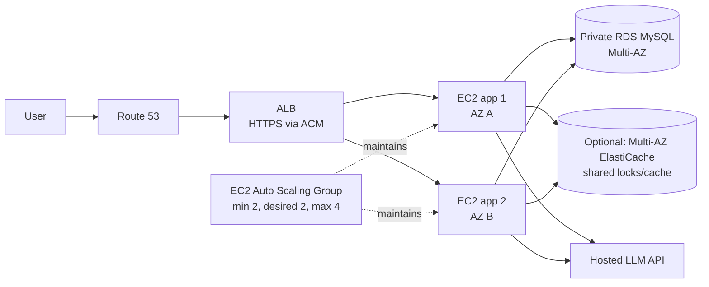

# AWS High Availability Without Kubernetes

Status: proposed production architecture. Nothing in this document has been deployed.

## Recommendation

Use an Application Load Balancer (ALB), an EC2 Auto Scaling Group (ASG), and Amazon RDS for MySQL. This gives the app two independent hosts and a managed database failover path without operating Kubernetes.

This is for an always-on, low-to-moderate traffic production service. It costs materially more than the single Lightsail VM that is suitable for sharing a demo. "Always available" is a target, not a guarantee; availability still depends on the region, AWS services, app code, model provider, DNS, and database.

## Architecture

- Put the ALB in public subnets in at least two Availability Zones. Attach an ACM TLS certificate and a Route 53 alias record to the ALB.
- Put app instances in private subnets across those Availability Zones. Allow inbound app traffic only from the ALB security group. Allow SSH only through Systems Manager Session Manager or a restricted admin path.
- Run two app instances as the minimum and normal desired capacity, distributed across two AZs. Set a tested maximum, such as four, to bound spend. Use On-Demand instances for the serving minimum; Spot is optional only for interruption-tolerant extra capacity.
- Use an EC2 launch template with an immutable container image in ECR and a startup routine that reads secrets, starts the app, and reports health. Use an ASG instance refresh with launch-before-terminate settings for releases.
- Use private Multi-AZ RDS for MySQL. Do not store the only copy of MySQL data on an app instance or local EBS disk. Restrict the RDS security group to the app security group.
- Use one small Multi-AZ ElastiCache Redis replication group for shared chat locks and cache invalidation if those features are enabled. A database-backed lease can be an initial alternative, but do not rely on process-local locks across two app servers.
- Store credentials in Secrets Manager and grant each EC2 instance a minimal IAM instance role. Keep JWT signing key identical across instances and stable across restarts.
- Send application, ALB, ASG, and RDS metrics/logs to CloudWatch. Alert on zero healthy targets, low healthy host count, repeated instance replacement, RDS failover, database connections/storage, API 5xx and latency, and model provider errors/spend.

## Failure handling

| Failure | What handles it | Expected effect |
| --- | --- | --- |
| API process dies or stops answering | ALB target health check removes that instance from routing; ASG uses ELB health checks and launches a replacement. | The other app instance keeps serving while replacement boots. |
| EC2 instance or host fails | EC2/ASG health checks mark it unhealthy and maintain the desired capacity. | Requests go to the other healthy instance; a new instance starts from the launch template. |
| One Availability Zone fails | ALB and ASG span two AZs; RDS Multi-AZ keeps a standby in another AZ. | Service continues from the surviving AZ if it has enough capacity. It may be slower until ASG restores the second AZ. |
| App deployment is bad | ASG instance refresh uses health checks and can roll back to a prior launch template/image. | Old healthy instances remain until replacements are healthy. Use a minimum healthy percentage that launches new instances before terminating old ones. |
| RDS primary fails | RDS Multi-AZ promotes the standby and retains the database endpoint. | Existing connections break; the app must reconnect/retry transient database errors. AWS reports typical failover at 60–120 seconds, but it can take longer. |
| Traffic grows | ASG target tracking scales out based on average CPU or ALB requests per target; set min/desired/max to keep an availability floor and cap spend. | A new instance registers only after startup and health checks. Very sudden bursts can see delay before capacity is ready. |
| Hosted LLM is slow or unavailable | Existing request timeout/fallback behavior and bounded concurrency handle provider failure. | Storefront and non-AI routes remain usable; AI answers can degrade. More EC2 instances do not raise provider quotas. |

EC2 Auto Scaling maintains desired capacity and can replace instances reported unhealthy by EC2 or the attached load balancer. The ALB sends requests only to healthy targets. RDS handles Multi-AZ failover, typically in 60–120 seconds, though timing varies. See [ASG health checks](https://docs.aws.amazon.com/autoscaling/ec2/userguide/health-checks-overview.html), [ALB target groups](https://docs.aws.amazon.com/elasticloadbalancing/latest/application/load-balancer-target-groups.html), and [RDS Multi-AZ failover](https://docs.aws.amazon.com/AmazonRDS/latest/UserGuide/Concepts.MultiAZ.Failover.html).

## App-specific changes before using two instances

1. **Remove process-local coordination.** The repo's production checklist notes that simultaneous chat turns for one customer are not serialized. A lock in Python memory cannot coordinate two EC2 hosts. Use a Redis distributed lock with a short lease, or a database lease that expires safely.
2. **Address process-local caches.** `api/main.py` caches catalog responses for 10 minutes and dashboard data for five minutes in each process. Product edits invalidate only the process handling the edit. Either accept and document that stale window or use shared Redis caching/pub-sub invalidation.
3. **Run scheduled work once.** `ai.scheduler run` is designed as a separate process. Do not start it on both ASG instances. Run it as a singleton ECS service/task with controlled replacement, or schedule idempotent ECS tasks through EventBridge. A database lease can prevent overlapping executions.
4. **Use small connection pools.** Per process the current upper bounds can reach 15 app + 18 customer-agent + 10 seller-agent + 10 admin-agent connections. With two instances and one worker each, that could be up to 106 connections before migrations/monitoring. Set pool limits explicitly and size RDS `max_connections` for `instance count × workers × sum(pool limits)` plus operational headroom.
5. **Create remote MySQL grants.** The three AI DB-user setup modules currently create accounts for `localhost` and `127.0.0.1`. For RDS, adapt them to create accounts usable only from the app VPC/private address pattern, then restrict network access with the RDS security group. Avoid an unrestricted public DB or root credentials in the app.
6. **Require production secrets.** `api/main.py` generates a temporary JWT signing secret if `JWT_SECRET` is missing. Make production startup fail instead. Set secure cookies behind HTTPS, turn off `DEMO_LOGIN`, and store all model and database passwords in Secrets Manager.
7. **Protect model spend and endpoints.** The production checklist records guest quota bypass and a reporting-only AI budget. Enforce a shared per-user/IP and global limit before making model calls. Bound model concurrency across both hosts.
8. **Make requests safe during failover and shutdown.** Reconnect the MySQL pool on transient disconnects; retry only safe/idempotent operations. Configure ALB deregistration delay/connection draining long enough for streamed chat responses and make the app stop accepting new work before instance termination.
9. **Keep local embeddings off.** Set `AI_LOCAL_EMBEDDINGS_ENABLED=false` and install `requirements.txt`, not `requirements-dev.txt`. The production dependency set excludes Torch/sentence-transformers; the app ignores old `hybrid` database settings. Current observed DB settings are LLM mode for all roles and RAG off. Use hosted embeddings only if tool-pack RAG is deliberately enabled.
10. **Close the existing production checklist.** In addition to items above, finish model budget enforcement, guest abuse limits, secure cookies, least-privilege app DB access, backups and a restore test, retention/privacy review, and load tests.

## Right-size for the initial release

- Keep one Uvicorn worker per EC2 instance. The local API process reached about 210 MiB peak resident memory during startup and catalog requests, without a chat load test. Use 2 GiB per instance as a first production benchmark with the local model disabled, then adjust from Linux memory/CPU and realistic concurrency tests.
- Begin with two instances across two AZs, not one instance that scales to two only after a failure. Reactive scaling cannot replace the pre-existing second copy's immediate availability.
- Start ASG target tracking at about 60% average CPU or a tested requests-per-target threshold. Alarm and test the actual busy-work profile before enabling scale-in. Set maximum capacity and cooldown/warmup values.
- Put a fixed budget alarm on AWS spend. ALB, RDS, EC2, NAT, logs, and model API all charge separately.
- Use private instances. They need outbound access for ECR, Systems Manager, and the hosted model API. NAT gateways provide this path but have a fixed hourly charge; VPC endpoints and a carefully designed egress path can reduce some network charges. Keep the security trade-off explicit.

## Cost shape

Exact prices depend on region, instance class, traffic, storage, backups, and egress. Obtain an AWS Pricing Calculator estimate before launch. This architecture's continuously running baseline includes:

- Two EC2 instances (the always-on minimum; app capacity cannot scale to zero).
- One ALB, charged hourly plus traffic/LCU usage.
- Multi-AZ RDS for MySQL, including both primary and standby compute plus storage and backups.
- Private-subnet outbound networking. Two NAT Gateways improve AZ independence but add two hourly charges plus data processing; AWS currently documents an example rate of `$0.045/hour` per NAT Gateway in US East (Ohio).
- CloudWatch logs/metrics/alarms, Route 53, public IPv4, ECR storage/transfers, and hosted model usage.

For comparison, the ALB base hourly example is `$0.0225/hour` in US East (N. Virginia), before LCU use. One NAT Gateway at `$0.045/hour` is about `$32.85/month` before data processing; two are about `$65.70/month`. These are separate from the compute and database bill. Sources: [ALB pricing](https://aws.amazon.com/elasticloadbalancing/pricing/), [VPC/NAT pricing](https://aws.amazon.com/vpc/pricing/), and [RDS for MySQL pricing](https://aws.amazon.com/rds/mysql/pricing/).

This is not a low-cost demo environment. A single Lightsail server is still the economical way to share the current project, but it cannot stay available through a host/AZ outage. The two-instance design pays for spare capacity on purpose so a failure does not take the whole app offline.

## Rollout plan

1. **Prepare the app:** implement required secret checks, secure cookies, distributed chat lock/cache policy, pool limits, and singleton scheduler execution. Keep the local model off.
2. **Containerize and rehearse:** build one API+React image, serve it on one EC2 instance, test RDS connection, HTTPS, model provider, and graceful streaming shutdown.
3. **Create redundant staging:** two AZs, ALB, ASG min/desired 2, Single-AZ RDS initially, CloudWatch alarms, and image-based rolling deployment. Load-test and terminate an app instance to verify replacement.
4. **Enable database HA:** promote to Multi-AZ RDS, perform a failover exercise, and verify API reconnect/retry behavior. Take and restore a backup in a separate test DB.
5. **Launch production:** use Multi-AZ RDS, Redis if needed for shared cache/locks, strict security groups, Secret Manager, model budget/rate limits, and alarms. Confirm owner and monthly spend ceiling.
6. **Scale by evidence:** increase ASG max only when ALB queue/latency, CPU, memory, or pending request metrics show a need. Do not scale nodes based only on total traffic if the bottleneck is RDS connections or model provider quota.

## References

- [EC2 Auto Scaling overview](https://docs.aws.amazon.com/autoscaling/ec2/userguide/what-is-amazon-ec2-auto-scaling.html)
- [ASG health checks](https://docs.aws.amazon.com/autoscaling/ec2/userguide/health-checks-overview.html)
- [ALB target groups and target health](https://docs.aws.amazon.com/elasticloadbalancing/latest/application/load-balancer-target-groups.html)
- [ASG instance refresh](https://docs.aws.amazon.com/autoscaling/ec2/userguide/instance-refresh-overview.html)
- [RDS Multi-AZ failover](https://docs.aws.amazon.com/AmazonRDS/latest/UserGuide/Concepts.MultiAZ.Failover.html)
- [EKS plan for comparison](AWS_EKS_PRODUCTION_PLAN.md)
